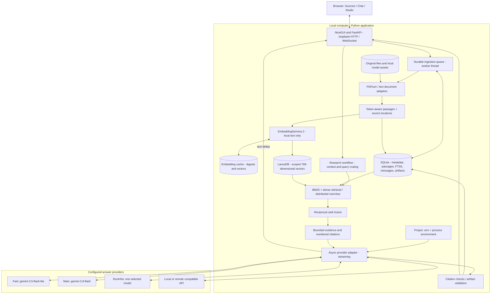
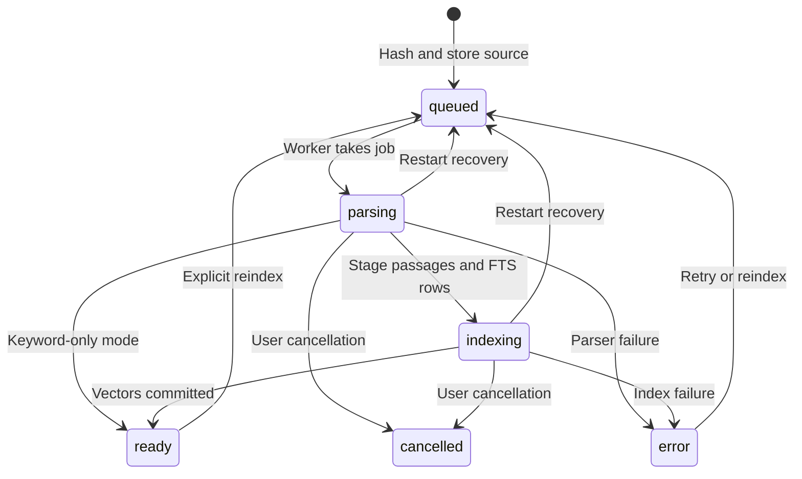
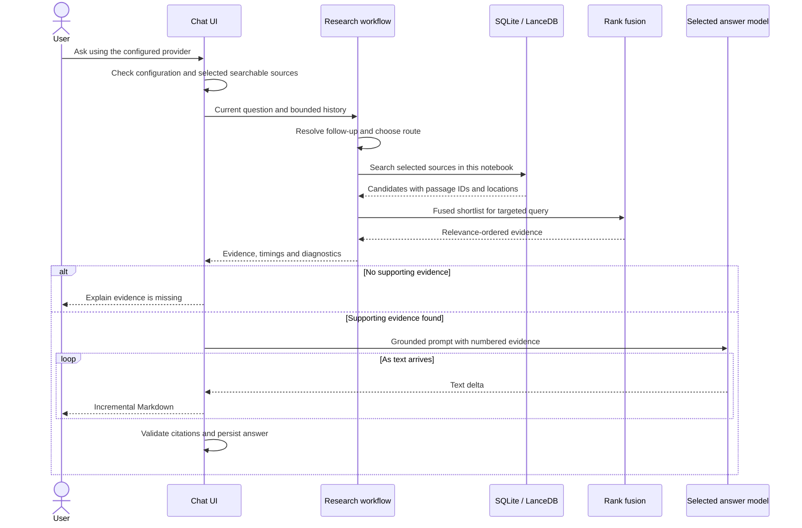

# Folio system architecture

Folio is a local, single-user RAG application. Documents are parsed, indexed, searched, and linked to evidence on this computer. The selected Gemini, RunInfra or compatible provider receives the question, bounded conversation history and selected text evidence to generate an answer.

This document describes the implemented text-only system as of October 11, 2026. Future work is separated in [the implementation plan](../PROJECT_PLAN.md).

## Components and deployment

There is no external vector service, application account, Redis queue, or separate frontend build. NiceGUI serves the UI; a small Vue component implements the mind map. Parsing, embedding, and retrieval run outside the UI event loop. A compatible API adapter remains available for explicitly configured local or remote endpoints.

## Configuration and model selection

| Setting | Authority | Default |
| --- | --- | --- |
| Gemini key | `GEMINI_API_KEY` in `.env` or process environment | Empty; user supplies it |
| Fast model | `GEMINI_FAST_MODEL` | `gemini-3.5-flash-lite` |
| Main model | `GEMINI_MAIN_MODEL` | `gemini-3.8-flash` |
| Retrieval and Main thinking preferences | Non-secret SQLite settings | Gemma + keyword fusion, minimal thinking |
| Data directory | `NOTEBOOK_DATA_DIR` | `.data` |
| Embedding threads | `NOTEBOOK_EMBED_THREADS` | Half logical CPUs rounded down, bounded to 1–6 by default; configurable from 1 to 8 |
| RunInfra credential/model | `RUNINFRA_API_KEY`; non-secret SQLite model selection | `glm-5-3-flash`; other configured choices in `config.RUNINFRA_MODELS` |
| Compatible credential/endpoint | `NOTEBOOK_API_KEY`; SQLite endpoint and model settings | Loopback compatible base URL; remote endpoints require HTTPS |
| CPU backend | `NOTEBOOK_EMBED_BACKEND` | OpenVINO for eligible x86 CPU snapshots; `pytorch` override |

The loader resolves `.env` relative to the project, not the launch directory. Project file values override inherited process variables, including a deliberately blank key. A stale environment key cannot shadow the project file. Editing `.env` requires a restart. Both Gemini model slots accept only the two IDs above. Persisted model names cannot override Gemini environment configuration; obsolete backup settings are discarded. There is no automatic switch to another model.

Keys are not entered through the browser or fetched from the OS credential store. The application does not save keys in SQLite, notebook exports, or artifacts. `.env` is Git-ignored; `.env.example` is a blank template. Connection status exposes presence, never the key. Configuration does not prove that a provider grants access to either model.

## Indexing lifecycle

1. Hash uploaded bytes, reject duplicates within the notebook, and store the original under an internal filename. Uploads are bounded at 150 MB; URL downloads at 25 MB.
2. Stream page, row, or section text through adapters. Digital PDFs use PDFium. OCR, image uploads, visual PDF/Office extraction and audio are disabled by `TEXT_ONLY=True`. Scans need an externally supplied searchable text layer. Location metadata travels with each text record.
3. Semantic indexing uses the embedding tokenizer: 512 tokens with 64-token overlap, preferring sentence boundaries. Keyword-only indexing uses LlamaIndex sentence splitting. All parsed units are processed, not just the first pages.
4. Stage text in SQLite batches of 256. FTS5 triggers maintain the keyword index. Store actual tokenizer counts for batch ordering; the source UI shows simple Indexing/Ready status.
5. Read batches of eight ordered by `token_count,ordinal`. Reuse embeddings by content and model contract; token grouping reduces padding. Fully cached imports do not initialize the inference model.
6. Upsert vectors, then commit each record's `vector_ready` flag and progress. Sources in `indexing` or `ready` are eligible for retrieval: all staged text can be searched, but dense coverage remains incomplete until ready. Check cancellation between parser units and batches.

SQLite WAL and committed checkpoints make progress durable. Interrupted jobs are requeued and reparsed, skipping records with committed vectors even when batch order differs from document order. Deterministic IDs and upserts make replay idempotent. Extraction does not resume from a PDF byte offset. SQLite and LanceDB do not share a transaction; replay can repeat a vector upsert before committing its flag. Retrieval discloses incomplete semantic indexing. Deletion removes metadata immediately and records cleanup in `source_cleanup`; originals and vectors are removed after in-flight work releases them.

Indexing time depends on token volume, hardware, model download and graph startup. Eligible x86 CPUs use a cached OpenVINO FP32 text graph once the snapshot exists; `NOTEBOOK_EMBED_BACKEND=pytorch` selects the PyTorch alternative. CUDA uses PyTorch bfloat16 where supported, otherwise float32; other CPU architectures use PyTorch float32. Vision/audio configurations are disabled and quantization is not enabled. First conversion/compilation adds time. Changing the embedding model or chunking contract requires a versioned rebuild and retrieval evaluation.

## Question-to-answer flow

Targeted retrieval searches the available index of selected sources in `ready` or `indexing` state. Explicit new topics stand alone; referential follow-ups use prior context. Compound-name matching and comparison aspects supplement query matching. BM25 and dense search each return up to 40 candidates. Reciprocal rank fusion uses `1 / (60 + rank)`; there is no separate reranker. Weak dense-only neighbors are filtered by a cosine similarity heuristic; keyword matches remain available for exact identifiers. Duplicate text is removed. Chat normally keeps eight passages within the retrieval text budget, then packs evidence and labels into a 30,000-character prompt budget. The answer model must decline unsupported questions. The similarity threshold is a retrieval heuristic requiring evaluation, not a calibrated probability. Image evidence and attachments are disabled.

Broad overviews use distributed source coverage rather than literal search for “key ideas.” Up to 80 passages are sampled across sources and document positions. Context packing preserves breadth instead of consuming the budget at the beginning of a book. This is bounded synthesis, not an exhaustive review in one API request. Full-document hierarchical synthesis is planned separately. All successfully parsed text is searchable, while each answer uses a bounded evidence set.

The model is instructed to use evidence, cite factual claims, and abstain when unsupported. Citation checks confirm IDs exist in the prompt; they do not prove entailment. Links retain source locations. Prior conversation is not accepted as fresh documentary evidence.

## Streaming and failure handling

- Gemini connections are reused per event loop and credential. Fast and Studio default to the configured Flash-Lite; Main selects the configured Flash. Fast requests minimal thinking independently of the Main setting.
- RunInfra uses one selected model across chat/planning/Studio. Its model can change in Settings or the composer; in-flight runs retain their selected model. Compatible connections are pooled per event loop.
- Text deltas render incrementally with UI throttling. A normal question does not wait for a separate model call for query rewriting or a title.
- Fast has a 20-second first-text deadline per attempt. Main and later stream gaps use a 60-second idle deadline. The operation has a 300-second overall bound.
- Transport failures, timeouts, and selected 5xx errors retry the same model once, only before any text is delivered. Authentication, missing-model, and quota errors surface without an automatic model switch.
- After partial output, the app preserves the answer and reports the interruption. Stop/cancel closes the stream. Manual retry and switching Fast/Main remain user actions.
- Missing configuration explains how to fill `.env` and restart. Provider errors remain visible with retry controls. Raw excerpts are not substituted for generated answers.

Retrieval latency, indexing elapsed time, and generation time to first text are separate measurements. A provider timeout after successful retrieval does not mean embeddings are slow. Remote API latency is not guaranteed.

## Studio and presentation

Studio retrieves topic evidence or distributed overview coverage. Quizzes use an 18,000-character evidence budget; other outputs use up to 30,000. Pydantic validates quiz answers and mind-map structure. Mind maps allow up to 80 nodes, require source references on leaves, and offer colored branches, individual expansion, expand/collapse all, zoom and an interactive canvas. Reports use Markdown and citation checks. Notes and validated artifacts persist locally and export with available source references.

The map camera pans independently of content bounds; individual topics can move
with their connecting curves. Pointer gestures support mouse, pen and touch,
including pinch zoom; wheel zoom stays anchored under the pointer. Fit map and
Reset layout recover the view. Resize preserves the camera or refits an untouched
view. Manual topic positions are component state, not persisted artifact content.
Studio generation tasks belong to the notebook page session; minimizing keeps
them running, but reload/restart does not provide durable Studio-job recovery.

## Persistence and trust boundaries

| Store | Contents | Lifecycle |
| --- | --- | --- |
| `.data/notebook.db` | Sources, notebooks, passages/FTS, messages, artifacts, non-secret preferences | Durable; metadata deletions cascade |
| `.data/vectors/` | Passage vectors with notebook/source IDs | Rebuilt on reindex; scope-filtered before ranking |
| `.data/embedding-cache.db` | Text/model digests and vectors | Reused across imports; survives source deletion |
| `.data/originals/` | Original documents | Private local source storage |
| `.data/models/` | Local model assets | Reused across runs |
| `.env` | Provider key and model configuration | Local, ignored by Git |

The server binds to loopback and checks HTTP/WebSocket hosts and origins. URL imports reject private-network destinations and recheck redirects. Ordinary chat does not execute source instructions, macros, or model tools. Gemini web discovery is a separate explicit operation. Cloud generation sends retrieved text outside the computer; local indexing does not make cloud generation offline. This is a local application boundary, not multi-user authorization.

## Evaluation and release gates

The [RAG evaluation protocol](RAG_EVALUATION.md) separates retrieval quality from answer quality.

| Layer | Evidence |
| --- | --- |
| Ingestion | Token bounds, passage/page locations, checkpoint recovery, cancellation, embedding reuse |
| Retrieval | Recall@8, MRR@8, nDCG@8, topic switches, follow-ups, isolation, abstention |
| Answers | Reference completeness, correctness, citation validity, claim support with evidence quotes |
| Runtime | First text, partial-stream recovery, same-model retries, cancellation, no legacy-key fallback |
| Browser | No key prompt, environment guidance, streaming, persistence, responsive UI and mind maps |

Run unit tests, Ruff, isolated browser checks, and the keyword RAG gate without API access. Run hybrid evaluation after retrieval changes. Run live generator/judge evaluations with the configured Gemini pair once the user supplies a key. Model judgments are fallible; contradictory or unverifiable judgments need human review. Developer fixtures and historical timings do not establish arbitrary-book accuracy or availability of the configured endpoints.

## Code map

| Module | Responsibility |
| --- | --- |
| `config.py`, `main.py` | Environment, startup, local access boundary |
| `storage.py` | SQL schema, persistence and non-secret settings |
| `ingestion/` | Parsers, jobs, chunking, recovery, discovery |
| `retrieval/` | Embeddings, vectors, fusion, workflow |
| `providers.py`, `chat.py` | Streaming, retry boundaries, prompts, citations |
| `studio.py`, `exports.py` | Structured generation and exports |
| `ui/` | NiceGUI pages, controls, mind-map component, CSS |
| `evaluation.py`, `benchmarks/`, `tests/`, `scripts/` | Metrics, fixtures, performance and browser checks |

Embedding migration uses index version **4** (SQLite `user_version` is separately 3). Only the `embeddinggemma2_v1` LanceDB table is queried. Older ready sources are queued once at startup and rebuilt with the current text-only contract. Originals, messages and stored citation snapshots survive. Cache identity includes model revision, dimensions, prompt and normalization; retained image helper contracts are inactive in the product pipeline.

Chunk IDs include the indexing version, so old citation links cannot silently point to different text after rebuilding. The dense-only text score cutoff is a heuristic checked on authored development fixtures and requires domain-specific evaluation. Retained image/OCR helpers and older multimodal benchmark results do not imply active image support.
